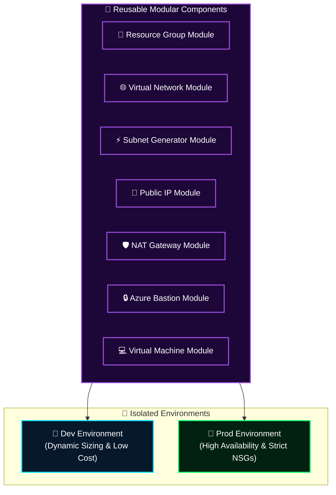

<div align="center">

# 🏛️ Azure CAF Modular Infrastructure Framework
### Enterprise Multi-Environment Terraform Architecture (Bastion, NAT Gateway & Multi-Tier Compute)

[](https://azure.microsoft.com)
[](https://terraform.io)
[](#-architectural-framework)
[](#-multi-environment-topology)

**Designed by [Mihir Maurya](https://github.com/MihirMaurya-dev) · Enterprise Cloud Architect & DevSecOps**

</div>

---

## 🏗️ Architectural Framework

This repository provides an enterprise-ready, modular Infrastructure as Code (IaC) framework implementing the **Microsoft Cloud Adoption Framework (CAF)**. It separates reusable infrastructure building blocks into individual modules and orchestrates multi-tier enterprise deployments across isolated `Dev` and `Prod` environments.



---

## 🧰 Technology Stack & Tooling

<div align="center">

<a href="https://skillicons.dev">
  
</a>

</div>

<br/>

---

## 📂 Repository Topology

```text
azure-caf-modular-iac/
├── Environments/
│   ├── Dev/                  # 🧪 Development environment deployment
│   │   ├── main.tf           # Module orchestrations
│   │   └── variables.tf
│   └── Prod/                 # 🚀 Production environment deployment
│       ├── main.tf           # Production sizing & security controls
│       └── variables.tf
│
└── modules/                  # 🧩 REUSABLE TERRAFORM MODULES
    ├── bastion/              # Azure Bastion Host for zero-public-IP management
    ├── NAT gateway/          # Outbound Internet egress security
    ├── public_ip/            # Standard SKU Public IP allocations
    ├── resource_group/       # Resource Group & Tagging governance
    ├── subnet/               # Subnet & NSG association generator
    ├── virtual_machine/      # Managed disk compute instances with OS profiles
    └── virtual_network/      # Address space and DNS configurations
```

---

## 🔒 Security & Governance Controls

1. **Zero Public Ingress for Compute**:
   Virtual machines have no public IP addresses assigned. All administrative access is strictly channeled through **Azure Bastion** over TLS.
2. **Deterministic Egress Control**:
   Outbound traffic from private subnets is routed through an enterprise **NAT Gateway** with static egress IPs.
3. **Environment Isolation**:
   `Dev` and `Prod` environments maintain distinct state files and variable specs to prevent environment crosstalk.

---

<div align="center">

**[Portfolio](https://mihirmaurya-dev.github.io/)** · **[LinkedIn](https://linkedin.com/in/mihirmauryaa1)** · **[DevOps Knowledge Vault](https://github.com/MihirMaurya-dev/DevOps-Notes)**

</div>
